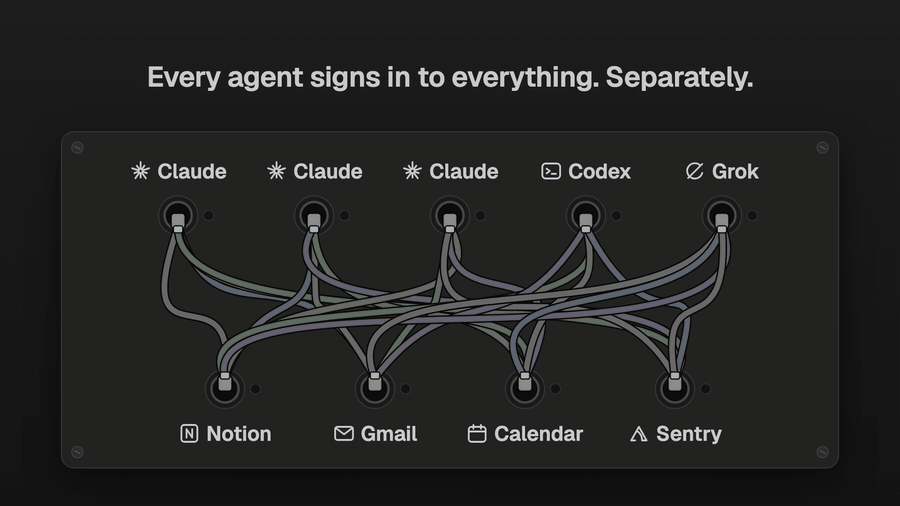

# Plugboard

<a href="docs/media/plugboard.mp4"></a>

<sub>18 s. Click for the video with sound.</sub>

One MCP server for all your agents. Plugboard signs in to each service
(Notion, Sentry, Cloudflare, Gmail, Google Calendar, DeepWiki, or any MCP
server you add) once, and gives every agent on your Mac the same URL:
Claude Code with as many logins as you have, Codex, Grok, Muse, or anything
else that speaks MCP over HTTP. Calls that reach other people or can't be
undone wait for you to approve them first, and every call is logged.

The command, the data folder and the code still use its first name,
`connectors`.

It runs on macOS, on your own Mac or on another always-on Mac reached over
Tailscale. It keeps your tokens on that machine; nothing goes through a
third party.

## Why

Connectors in AI apps belong to one login of one app. Every new Claude
account has to be connected to Notion, Gmail and the rest again, Codex has
its own separate set, and other agents have none. If you run several logins
(a pool that moves a thread between accounts, say), a thread may or may not
have your Gmail depending on where it lands.

Connectors moves the sign-ins to one small server you run. Each agent gets
its own token for that server instead. Because every call goes through it,
it's also the one place to see what your agents send and to say "ask me
first" for things like sending an email or deleting a page.

- One sign-in per service, for every agent and every provider.
- Approvals: sending, replying, deleting, sharing and inviting wait for you
  on an approval page (with an optional push to your phone). Page edits and
  reads don't.
- A call log of what each agent called, with what, and how it went.
- Agents are told when a service needs signing in, with a link to give you,
  instead of finding nothing.

## Get it

Paste this into your AI coding agent (Claude Code, Codex, Cursor...):

> Fork https://github.com/mikecann/plugboard to my GitHub account and clone my fork
> (if I don't use GitHub, or want to keep my copy private, just clone it instead),
> then make it my own. It's one of Mike Cann's personal tools, so read the README
> first, change anything specific to his setup to suit mine, then help me get it
> running.

Or set it up by hand with the quick start below.

## Quick start (one Mac)

You need an Apple silicon Mac and Node.js with npm (any recent version, only
to build; the gateway runs on a pinned Node 26 that the installer
downloads and checks).

```bash
git clone https://github.com/mikecann/plugboard.git
cd plugboard
scripts/install.sh --owner Sam
```

That:

1. builds the gateway and installs it in
   `~/Library/Application Support/Connectors/` with a LaunchAgent
   (`local.connectors`) that keeps it running on `http://127.0.0.1:8795`,
2. writes `config/settings.json` and `config/agents.json` there (local
   mode, and two agents, `claude` for `~/.claude` and `codex`),
3. makes a token for each agent and wires Claude Code and Codex to the
   gateway (`scripts/install-clients.sh`, below),
4. puts the `connectors` command in `~/.local/bin` and opens the admin
   page.

On the admin page, press Connect next to Notion. Your agents see its tools
from their next session (Claude Code sessions that are open see them
straight away). DeepWiki needs no sign-in.

`--owner` is what agents call you ("Waiting for Sam to approve this");
without it they say "the user".

### The admin pages in local mode

The admin and approval pages only answer on this Mac, to a browser that
has signed in with `connectors open`:

```bash
connectors open                        # the admin page
connectors open /admin/connect/notion  # one service's Connect page
```

`connectors open` makes a one-time code that works for two minutes and
opens the page with it; the page swaps it for a cookie that lasts a year.
After that, the links agents give you (approvals, Connect pages) open
straight away in that browser. A browser without the cookie gets a page
telling it which `connectors open` command to run.

## Wire your agents

Agents are listed in `~/Library/Application Support/Connectors/config/agents.json`:

```json
[
  { "id": "claude", "title": "Claude Code", "upstreams": ["*"], "client": { "type": "claude" } },
  { "id": "claude-work", "title": "Claude (work login)", "upstreams": ["*", "!tag:personal"],
    "client": { "type": "claude", "configDir": "~/.claude-work" } },
  { "id": "codex", "title": "Codex", "upstreams": ["*"], "client": { "type": "codex" } },
  { "id": "grok", "title": "Grok", "upstreams": ["*"], "toolSeparator": "_", "client": { "type": "grok" } }
]
```

- `id`: lowercase letters, digits and dashes. Each agent gets its own token,
  and the call log and approval pages show which agent did what.
- `upstreams`: which services it may use. Ids, globs, `tag:<tag>`, and `!`
  in front to exclude.
- `client`: what `install-clients.sh` wires for it. `type` is `claude`,
  `codex`, `grok` or `muse`; `configDir` is that client's config folder
  when it isn't the default (`CLAUDE_CONFIG_DIR` for another Claude login,
  `CODEX_HOME`, `GROK_HOME`, or Muse's settings folder). An agent without a
  `client` gets a token but isn't wired.
- `toolSeparator: "_"` gives `<prefix>_<tool>` tool names for clients that
  refuse a second `__` (Grok).

Then run:

```bash
scripts/install-clients.sh --dry-run   # see what would change
scripts/install-clients.sh
```

For each agent it gets a token from the gateway and keeps it in the login
Keychain (service `connectors`, account `<agent id>`), without printing it.
Then:

- Claude Code: `claude mcp add-json --scope user connectors` with a
  `headersHelper` that runs `~/.config/connectors/headers.sh <agent>`, which
  reads the token from the Keychain.
- Codex: `[mcp_servers.connectors]` in `config.toml` with
  `http_headers_helper` and `tool_timeout_sec = 300`.
- Grok: `[mcp_servers.connectors]` in `config.toml` with
  `bearer_token_file` pointing at a 0600 file in `~/.config/connectors/`.
- Muse: `mcpServers.connectors` in its `settings.json` with a literal
  Authorization header, since Muse can't run a helper. The file is made 0600.

Config files are backed up next to themselves (`*.bak-connectors-<time>`)
before they change, and only the `connectors` entry is touched. Codex's and
Grok's configs are put back if `codex mcp get` or `grok mcp list` can't read
the result. A client that isn't installed is skipped and gets no token.
Running it again is safe. `--rotate` makes new tokens, `--only codex,grok`
limits it, and `--remove` takes everything out again. Your existing
claude.ai connectors and Codex apps are left alone; turn off the ones the
gateway replaces once you're happy, so there's one place to sign in.

For any other MCP client, make a token with `connectors agent add <id>`
(printed once) and point the client at `<public URL>/mcp` with the header
`Authorization: Bearer <token>`.

## Run it on another Mac (Tailscale)

If your agents run on more than one machine, or you want approvals to work
while your laptop sleeps, run the gateway on an always-on Mac and publish it
on your tailnet. Both machines need [Tailscale](https://tailscale.com), and
you need `ssh` to the other Mac.

```bash
scripts/install.sh --host studio --tailscale --owner Sam
```

This builds on your Mac and copies the release over ssh (nothing is built or
fetched on the other Mac), sets the gateway up there in tailscale mode, runs
`tailscale serve --bg --https=8443 http://127.0.0.1:8795` on it (unless 8443
already serves something else, which it leaves alone), wires the agents on
your Mac with tokens from the other Mac, and remembers the host in your
Mac's own `settings.json` (`gatewayHost`) for later deploys.

In tailscale mode the admin pages only answer requests that came through
`tailscale serve`, which adds the `Tailscale-User-Login` header, from a
login in `adminLogins`. The installer reads the tailnet name and your login
from Tailscale on the other Mac; pass `--public-url
https://studio.<tailnet>.ts.net:8443` and `--admin-login you@example.com` if
it can't. Open `https://studio.<tailnet>.ts.net:8443/admin` in a browser
signed in to Tailscale as that login.

You can also use tailscale mode on a single Mac (`scripts/install.sh
--tailscale`), so other devices on your tailnet can use it too.

## Updates

```bash
git pull
scripts/install.sh --no-open  # update, keeping your config, and re-wire the agents
```

`install.sh` goes where it went last time (`gatewayHost` in your Mac's
`settings.json`, or this Mac). For a deploy that runs the typecheck and
tests first, or to go back:

```bash
npx -y -p node@26 npm ci
scripts/deploy.sh             # typecheck, tests, build, deploy, check /health
scripts/deploy.sh --rollback  # back to the previous release that was live
```

`deploy.sh` goes to the same machine as `install.sh`, puts the
release in `releases/<id>/`, points `app` at it, restarts the LaunchAgent
and waits for `/health` to report the new release. If it doesn't come up,
`app` goes back to the previous release and the failed one is deleted. Only
releases that have served `/health` are kept as rollback targets (the live
one and two more). A deploy never touches `config/`, `secrets/` or
`state/`. A restart answers held calls at once with their approval id, so
agents can still await them afterwards. Other options: `--skip-checks`,
`--dry-run`, `--no-publish`, `--host <host>`, `--local`.

## Add a service

Copy the example into your config folder, then edit it:

```bash
cd ~/Library/Application\ Support/Connectors
cp app/config/upstreams.example.json config/upstreams.json
```

The example has Notion and DeepWiki on, and Sentry, Cloudflare, Gmail and
Google Calendar with `"enabled": false`; set `enabled` to `true` (or remove
it) to turn one on. A service with standard MCP sign-in (OAuth with dynamic
client registration) needs nothing else:

```json
{ "id": "linear", "title": "Linear", "prefix": "linear",
  "type": "http", "url": "https://mcp.linear.app/mcp", "auth": { "type": "oauth" } }
```

Restart the gateway to pick it up (`scripts/deploy.sh`, or
`launchctl kickstart -k gui/$(id -u)/local.connectors`), then press Connect
on the admin page.

- `id`: lowercase letters, digits and dashes. `prefix`: 1 to 10 lowercase
  letters or digits, unique, and not `connectors`. Tools are named
  `<prefix>__<tool>`, for example `notion__notion-search`.
- `auth.type`: `oauth` (press Connect), `none`, or `bearer` with the token in
  `secrets/upstream-tokens/<id>` (mode 0600).
- `auth.client: "static"` uses `secrets/clients/<id>.json`
  (`{"client_id": "...", "client_secret": "..."}`) instead of registering,
  for services that need their own OAuth client.
- `tags`, for agent allowlists (`"!tag:work"`).
- Local servers: `"type": "stdio"`, `"command"`, `"args"`, and `"env"`,
  where a secret value is `{"secretFile": "upstream-env/<name>"}` under
  `secrets/`. Commands come from config only, never from a request.
- Optional: `enabled`, `scopes`, `timeoutMs`.

URLs must be https, and the gateway refuses to call private, LAN, loopback
or tailnet addresses, even after a redirect.

### Approvals

`policy.json` (copy `app/config/policy.example.json` into `config/` to
change it) decides per tool: `allow`, `ask` or `deny`. First matching rule
wins, then `default`. The example asks before anything that sends, replies,
forwards, posts a message, deletes, trashes, shares, changes permissions or
invites, and before a calendar event with guests:

```json
{ "tool": "gcal__*event*", "ifArgs": ["attendees"], "action": "ask" }
```

Rules match `<prefix>__<tool>` with the service's own tool name, and can be
limited with `agents`, `upstreams`, or `ifArgs` (only when one of those
arguments is set and not empty).

A tool that `deny` refuses whatever the arguments is also left out of the
agents' tool lists, so it costs their models no context and can't be picked
by mistake. That makes `deny` a way to trim a big service down to the tools
you use. Put those rules first, since the first matching rule wins:

```json
{ "tool": "notion__notion-calendar-*", "action": "deny" }
```

An `ask` call waits up to 45 seconds. If you approve it in time, the agent
gets the real result. If not, the agent is told to tell you and then call
`connectors__await_approval` with the id, which waits up to 45 seconds more
and runs the call exactly once when you approve. Unanswered approvals
expire after 24 hours, and an approved call that no agent picks up within an
hour expires too.

For a push to your phone, pick a long random [ntfy](https://ntfy.sh) topic,
subscribe to it in the ntfy app, and put it in `secrets/ntfy-topic` (mode
0600). The push carries only a title ("Codex wants to run
gmail__send_message") and a link, never arguments.

## Gmail and Google Calendar

Google's own MCP servers only take Workspace accounts in a developer
preview, so the gateway runs its own small Gmail and Calendar servers and
signs in to Google itself. You need your own Google Cloud project and OAuth
client, because a shared client for everyone would need Google's paid
security review for Gmail access.

1. In the [Google Cloud console](https://console.cloud.google.com), create a
   project and enable the **Gmail API** and the **Google Calendar API**.
2. Set up the OAuth consent screen (Google Auth Platform): user type
   External, your own email as the support and developer contact. Add the
   scopes `gmail.readonly`, `gmail.compose`, `calendar.readonly` and
   `calendar.events`.
3. **Publish the app** (Audience, "Publish app", so its status is "In
   production"). In testing mode Google drops the sign-in after 7 days.
   You don't need to submit it for verification for your own use.
4. Create an OAuth client of type **Web application** with the redirect URI
   `<your public URL>/oauth/callback`, for example
   `http://127.0.0.1:8795/oauth/callback` in local mode or
   `https://studio.<tailnet>.ts.net:8443/oauth/callback` in tailscale mode.
5. Download the client's JSON and save it as `secrets/clients/google.json`
   (mode 0600) in the data folder. Either that file as downloaded or
   `{"client_id": "...", "client_secret": "..."}` works.
6. Turn on `gmail` and `gcal` in your `upstreams.json`, restart, and press
   Connect on `/admin/connect/gmail`.

Google then shows "Google hasn't verified this app". That's expected: it's
your own app, signing in to your own account. Choose Advanced, then "Go to
<app name> (unsafe)". Google asks once for Gmail (read, drafts, send) and
Calendar (read, events); the Connect page shows which Google account signed
in. If you untick Calendar, Gmail works and Calendar stays signed out.

Tools: `gmail__search_threads`, `get_thread`, `get_message`, `list_labels`,
`create_draft`, `send_message` (asks you), and `gcal__list_calendars`,
`list_events`, `get_event`, `create_event` and `update_event` (ask you when
there are guests).

## Security model

What it protects against: an agent sending something by mistake. An email,
a message, a deleted page or a changed permission waits for you, and the
call log shows exactly what each agent sent.

What it doesn't protect against: a rogue program running as you, on the
machine where your agents run. It can read the agents' tokens from the
Keychain or config files, and it can sign a browser in to the admin pages
(`connectors open`) or, in tailscale mode, reach them through Tailscale as
you. Passkey-protected approvals would be the upgrade for that.

What it is careful about:

- Tokens. Agent tokens are stored only as SHA-256 hashes, and the CLI prints
  a new one once. Upstream OAuth tokens and client secrets live in
  `secrets/` (0700 folder, 0600 files) and are never logged or shown. An
  agent's token is stripped before anything goes upstream; agents never see
  upstream tokens.
- Not being an OAuth server. The gateway only takes static bearer tokens and
  serves no `/.well-known/oauth-*` routes, which keeps it clear of the
  confused-deputy problem.
- Where it connects. Only configured upstream URLs, https only, never a
  private, LAN, loopback or tailnet address, checked again on every
  redirect and at DNS time.
- The admin and approval pages. In local mode they answer only on
  127.0.0.1, only with the expected `Host` header (so a web page that
  points its own name at 127.0.0.1 can't read them), and only to a browser
  with the sign-in cookie, which is HttpOnly and SameSite=Lax. In tailscale
  mode they answer only requests from `tailscale serve` for a login in
  `adminLogins`. Either way every button is a POST with a CSRF token, and
  posts from any other origin, other ports on 127.0.0.1 included, are
  refused. The banner only shows messages the server made, never text from
  a link.
- What you approve. Until a held call runs, its approval page shows the
  arguments exactly as they will be sent. Arguments with a `__proto__` key
  anywhere are refused, since a JavaScript upstream could turn one into
  values you never saw.
- Limits, so one runaway agent can't take the gateway down: 1 MB per
  request, 32 calls running at once per agent, 20 calls per agent waiting
  for approval, 10 MB per result, and a 384 MB heap.

The design and the reasoning behind it are in [docs/plan.md](docs/plan.md).

## Files and settings

Everything lives in `~/Library/Application Support/Connectors/`:

| Path | What |
| --- | --- |
| `config/settings.json` | mode, port, public URL, admin logins, owner name |
| `config/agents.json`, `upstreams.json`, `policy.json` | your config; a missing one means the shipped example (`app/config/*.example.json`) |
| `app` | the live release (a symlink into `releases/`) |
| `bin/connectors` | the CLI |
| `secrets/agents.json` | agent token hashes |
| `secrets/oauth/<upstream>.json` | OAuth client registration and tokens |
| `secrets/clients/<upstream>.json` | static OAuth clients (`google.json` for Gmail and Calendar) |
| `secrets/admin-key` | local mode: the key behind the admin sign-in cookie |
| `secrets/ntfy-topic` | optional ntfy topic for approval pushes |
| `state/connectors.sqlite` | call log, approvals |

Logs go to `~/Library/Logs/connectors.log`.

`settings.json` fields, all optional:

| Field | Default | What |
| --- | --- | --- |
| `mode` | `local` | `local` or `tailscale` |
| `port` | `8795` | where it listens, on 127.0.0.1 |
| `publicUrl` | `http://127.0.0.1:<port>` in local mode | base URL for links and the OAuth redirect; required in tailscale mode |
| `adminLogins` | none | tailscale mode: Tailscale logins allowed on the admin pages |
| `servePort` | `8443` | tailscale mode: the port `tailscale serve` publishes |
| `ownerName` | "the user" | what agents call you |
| `launchdLabel` | `local.connectors` | the LaunchAgent's label |
| `gatewayHost` | none | on the Mac where your agents run: the ssh host the gateway runs on |
| `sentryDsn` | none | optional: report the gateway's own bugs to your Sentry project |

`connectors settings` shows the settings in effect and which files are
used. Environment variables (`CONNECTORS_MODE`, `CONNECTORS_PORT`,
`CONNECTORS_PUBLIC_URL`, `CONNECTORS_ADMIN_LOGINS`, `CONNECTORS_OWNER`)
override the file, for testing.

Check on it:

```bash
connectors status                   # services, approvals waiting, calls today
curl -s http://127.0.0.1:8795/health
tail -n 50 ~/Library/Logs/connectors.log
```

`/health` needs no auth and returns `{ ok, version, release, upstreams }`,
one entry per service: `{ id, title, state, message, connectUrl, tools }`,
where `state` is `connected`, `connecting`, `signed_out`, `needs_setup`,
`error` or `disabled`. It never has emails or secrets.

With a `sentryDsn`, the deployed gateway reports its own bugs (crashes,
unhandled rejections, 500s from a route, a TypeError in a tool call) to
that Sentry project. Only the LaunchAgent reports: it also needs the
plist's `NODE_ENV=production` and a deployed `release.json`, so tests and
dev runs never do. Upstream failures aren't reported, and events carry no
request data, headers, tokens, tool arguments or results (see
`src/sentry.ts`). Without a DSN nothing is sent anywhere.

To remove it: `scripts/install-clients.sh --remove`, then
`launchctl bootout gui/$(id -u)/local.connectors`, delete
`~/Library/LaunchAgents/local.connectors.plist`, and delete the data
folder.

## Develop

Node 26 is required (`node:sqlite` cuts text at a NUL on older versions).

```bash
npx -y -p node@26 npm install
npx -y -p node@26 npm test           # unit and integration tests, no network
npx -y -p node@26 npm run check      # typecheck, tests and build
npx -y -p node@26 npm run test:clients              # real Claude, Codex, Grok and Muse CLIs
npx -y -p node@26 npm run test:clients -- --approvals   # plus a held call each
npx -y -p node@26 npm run test:browser   # admin pages in headless Chromium
npm run test:deploy                  # deploy.sh against a fake machine on this Mac
npm run lint:sh                      # shellcheck
```

To run a gateway from the source with a throwaway data folder:

```bash
npx -y -p node@26 node src/cli.ts init --home /tmp/connectors-dev
npx -y -p node@26 node src/cli.ts serve --home /tmp/connectors-dev
npx -y -p node@26 node src/cli.ts open --home /tmp/connectors-dev
```

Code map: [src/http.ts](src/http.ts) (routes and admin access),
[src/settings.ts](src/settings.ts) (settings and modes),
[src/config.ts](src/config.ts) (upstreams, agents, policy),
[src/mcp.ts](src/mcp.ts) (the MCP endpoint),
[src/gateway.ts](src/gateway.ts) (allowlists, policy, approvals, call log),
[src/upstreams.ts](src/upstreams.ts) (upstream connections and tool cache),
[src/oauth.ts](src/oauth.ts) (OAuth client provider),
[src/google/](src/google) (Google sign-in and the Gmail and Calendar
server), [src/ssrf.ts](src/ssrf.ts) (outbound guard),
[src/admin.ts](src/admin.ts) (pages), [src/cli.ts](src/cli.ts) (the
`connectors` command). How each MCP client behaves against it is in
[docs/client-compat.md](docs/client-compat.md).

## License

MIT, see [LICENSE](LICENSE).
